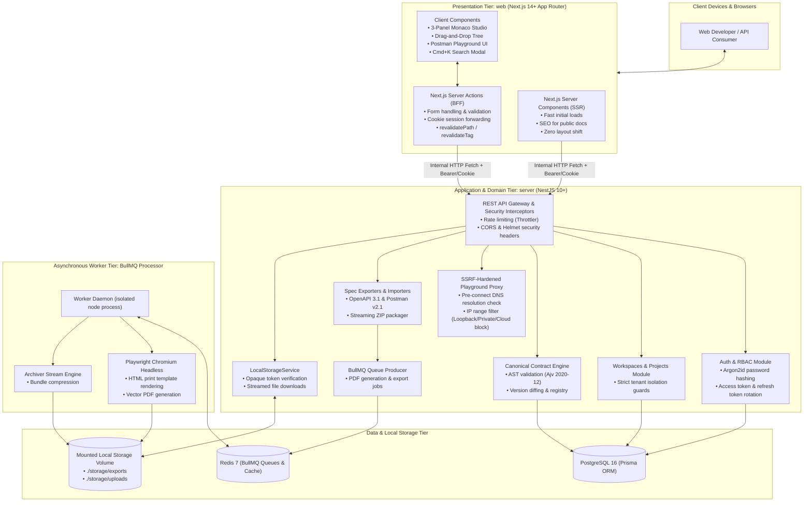
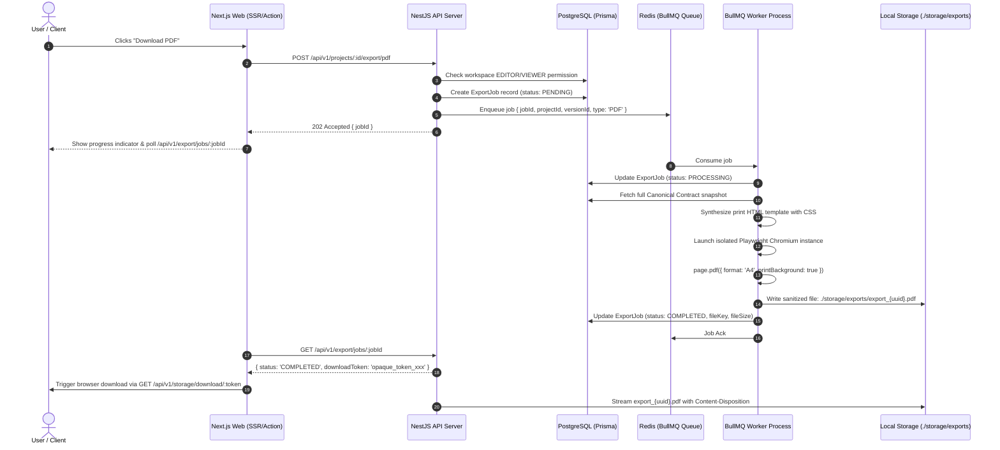

# ApiForge: System Architecture Specification

**Document Version:** 1.0.0  
**Status:** Approved for Architectural Review (Phase Zero)  
**Author:** Principal Software Architect & Technical Research Lead  
**Classification:** Technical Architecture  

---

## 1. High-Level System Architecture

ApiForge is structured as a modular full-stack monorepo with an explicit boundary between the presentation tier (Next.js) and the domain/data tier (NestJS), backed by PostgreSQL for persistence, Redis for queuing and distributed caching, and a secure local disk volume for export artifacts.



---

## 2. Tier Separation & Strict Architectural Boundaries

To ensure security, maintainability, and clean separation of concerns, the following architectural boundaries are strictly enforced:

### 2.1 The Presentation Tier (`web`)
- **Technology**: Next.js 14+ with App Router, TypeScript (strict mode), Tailwind CSS, shadcn/ui.
- **Responsibilities**:
  1. **Server-Side Rendering (SSR)**: Renders documentation pages (`/docs/[slug]`, `/[projectId]/docs`) and project dashboards on the server before transmitting HTML to the client. This guarantees lightning-fast First Contentful Paint (FCP) and prevents client-side loading flashes.
  2. **Backend-For-Frontend (BFF)**: Next.js Server Actions manage form submissions and mutations by calling the NestJS API with forwarded HTTP-only authentication cookies.
  3. **Client-Side Interactivity**: Dedicated client components handle the visual 3-panel schema designer, drag-and-drop hierarchy, Monaco code editor, and the Postman-style playground.
- **Prohibitions**:
  - **No direct database access**: Next.js must NEVER import Prisma Client or connect directly to PostgreSQL.
  - **No domain business logic**: Validation of contract semantics, permission calculations, and file system modifications must never be implemented inside Server Actions.

### 2.2 The Application Tier (`server`)
- **Technology**: NestJS 10+, TypeScript (strict mode), Prisma ORM, BullMQ, Ajv.
- **Responsibilities**:
  1. **Domain Truth**: All business logic, transaction boundaries, relational integrity, and domain events live exclusively here.
  2. **Security Gateway**: Independently validates authentication (JWT) and checks role-based and resource-level authorization on every request.
  3. **Outbound Proxy**: Executes external playground HTTP requests with deep SSRF defense.
  4. **Background Job Dispatcher**: Dispatches heavy tasks (PDF rendering, ZIP bundling) to Redis queues.
- **Prohibitions**:
  - No coupling to frontend rendering logic or JSX.

### 2.3 The Shared Package (`shared`)
- **Technology**: Pure TypeScript library compiled via Project References.
- **Responsibilities**:
  - Houses the Canonical Contract AST interfaces and types.
  - Houses pure converter logic (Canonical AST to OpenAPI 3.1, Canonical AST to Postman Collection v2.1).
  - Houses code generation utilities (cURL, Fetch, Python, Go generators).
- **Prohibitions**:
  - No database clients, no network dependencies, no framework-specific decorators (`@Injectable()`).

---

## 3. Asynchronous Worker Architecture (BullMQ + Playwright)

PDF rendering and ZIP bundling must never block the synchronous NestJS HTTP event loop.



---

## 4. Local Filesystem Storage Architecture

To achieve zero cloud operating cost and eliminate S3 vendor lock-in, ApiForge uses local volume storage engineered for security:

```
storage/
├── exports/              # Generated PDFs, OpenAPI exports, ZIP archives
│   └── [uuid].pdf
├── uploads/              # Brand logos, workspace assets
│   └── [uuid].png
└── tmp/                  # Temporary staging files for archiver streams
```

### Storage Security Contract:
1. **Opaque Token Authorization**: Users never pass raw filesystem paths. Instead, the backend generates a cryptographically random token (`crypto.randomBytes(32).toString('hex')`) stored in PostgreSQL or Redis with a 15-minute TTL, mapped to the user ID and file record.
2. **Path Traversal Defense**: All path resolutions are verified using `path.resolve` and checked against the root volume path. If `targetPath.startsWith(storageRoot)` is false or if null-byte injection (`\0`) is detected, the operation aborts with a security audit event.
3. **Automated Lifecycle & Retention**: BullMQ schedules a recurring cleanup job (`cron: 0 * * * *`) that removes export files older than 24 hours to prevent disk saturation.
