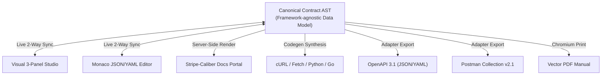
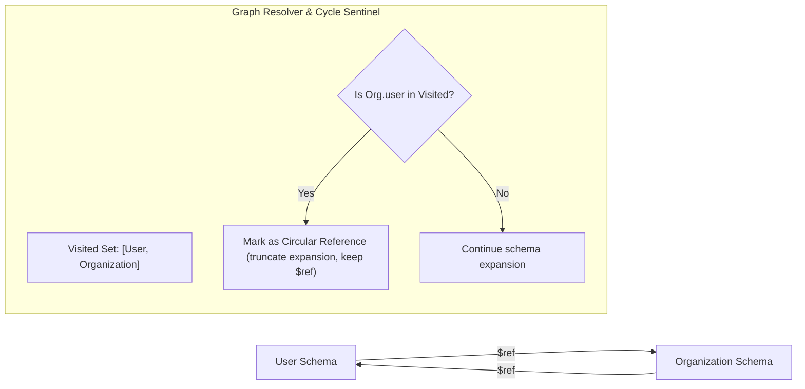

# ApiForge: Canonical Contract AST & Schema Engine Design

**Document Version:** 1.0.0  
**Status:** Approved for Architectural Review (Phase Zero)  
**Author:** Principal Software Architect & Technical Research Lead  
**Classification:** Domain Specification  

---

## 1. Domain Philosophy: The Canonical Model

ApiForge treats API contracts not as proprietary JSON blobs or Swagger documents, but as an **Abstract Syntax Tree (AST)** that acts as the single source of truth across all features:
- The **Visual 3-Panel Studio** renders and edits this AST.
- The **Monaco Editor** displays the AST serialized into JSON or YAML.
- The **Documentation Viewer** converts the AST into human-readable tables, navigation trees, and code samples.
- The **Exporters** compile the AST into OpenAPI 3.1.0 and Postman Collection v2.1.0 specifications.
- The **Playground** reads parameters and schemas from the AST to execute requests.



---

## 2. Canonical AST TypeScript Specification (`shared`)

```typescript
/**
 * Canonical Contract Root Model
 */
export interface CanonicalContract {
  id: string;
  name: string;
  version: string;
  description?: string;
  servers: CanonicalServer[];
  tags: CanonicalTag[];
  folders: CanonicalFolder[];
  endpoints: CanonicalEndpoint[];
  reusableSchemas: Record<string, CanonicalSchemaDefinition>;
  securitySchemes: Record<string, CanonicalSecurityScheme>;
  externalDocs?: {
    description?: string;
    url: string;
  };
}

export interface CanonicalServer {
  id: string;
  url: string;
  description?: string;
  variables?: Record<string, {
    default: string;
    description?: string;
    enum?: string[];
  }>;
}

export interface CanonicalTag {
  id: string;
  name: string;
  description?: string;
}

export interface CanonicalFolder {
  id: string;
  name: string;
  description?: string;
  orderIndex: number;
}

export type HttpMethod = 'GET' | 'POST' | 'PUT' | 'PATCH' | 'DELETE' | 'HEAD' | 'OPTIONS';

export interface CanonicalEndpoint {
  id: string;
  folderId?: string | null;
  method: HttpMethod;
  path: string;
  summary: string;
  description?: string;
  tags: string[];
  deprecated?: boolean;
  security: CanonicalSecurityRequirement[];
  parameters: CanonicalParameter[];
  requestBody?: CanonicalRequestBody;
  responses: CanonicalResponse[];
  orderIndex: number;
}

export type ParameterIn = 'path' | 'query' | 'header' | 'cookie';

export interface CanonicalParameter {
  id: string;
  name: string;
  in: ParameterIn;
  required: boolean;
  description?: string;
  deprecated?: boolean;
  schema: CanonicalSchemaDefinition;
  example?: any;
}

export interface CanonicalRequestBody {
  description?: string;
  required: boolean;
  content: Record<string, { // e.g. "application/json", "multipart/form-data"
    schema: CanonicalSchemaDefinition;
    examples?: Record<string, { summary?: string; value: any }>;
  }>;
}

export interface CanonicalResponse {
  id: string;
  statusCode: string; // e.g. "200", "201", "400", "404", "default"
  description: string;
  headers?: Record<string, {
    description?: string;
    required?: boolean;
    schema: CanonicalSchemaDefinition;
  }>;
  content?: Record<string, {
    schema: CanonicalSchemaDefinition;
    examples?: Record<string, { summary?: string; value: any }>;
  }>;
}

export type CanonicalDataType =
  | 'string'
  | 'number'
  | 'integer'
  | 'boolean'
  | 'object'
  | 'array'
  | 'null';

export interface CanonicalSchemaDefinition {
  type?: CanonicalDataType | CanonicalDataType[];
  title?: string;
  description?: string;
  nullable?: boolean;
  readOnly?: boolean;
  writeOnly?: boolean;
  default?: any;
  example?: any;
  
  // Enums
  enum?: (string | number | boolean)[];

  // String Constraints
  minLength?: number;
  maxLength?: number;
  pattern?: string;
  format?: 'date-time' | 'date' | 'time' | 'email' | 'uri' | 'uuid' | 'ipv4' | 'ipv6' | string;

  // Numeric Constraints
  minimum?: number;
  maximum?: number;
  exclusiveMinimum?: number;
  exclusiveMaximum?: number;
  multipleOf?: number;

  // Object Properties
  properties?: Record<string, CanonicalSchemaDefinition>;
  required?: string[];
  additionalProperties?: boolean | CanonicalSchemaDefinition;

  // Array Properties
  items?: CanonicalSchemaDefinition;
  minItems?: number;
  maxItems?: number;
  uniqueItems?: boolean;

  // Composition & Polymorphism (JSON Schema 2020-12 / OpenAPI 3.1)
  oneOf?: CanonicalSchemaDefinition[];
  anyOf?: CanonicalSchemaDefinition[];
  allOf?: CanonicalSchemaDefinition[];
  not?: CanonicalSchemaDefinition;

  // Reusable Reference
  $ref?: string; // e.g. "#/components/schemas/User"
}

export interface CanonicalSecurityScheme {
  id: string;
  name: string;
  type: 'apiKey' | 'http' | 'oauth2' | 'openIdConnect';
  description?: string;
  scheme?: 'bearer' | 'basic';
  bearerFormat?: string;
  in?: 'header' | 'query' | 'cookie';
  paramName?: string;
  flows?: any;
}

export interface CanonicalSecurityRequirement {
  schemeName: string;
  scopes: string[];
}
```

---

## 3. Circular Reference Detection & Graph Resolution

Complex schemas frequently reference each other (e.g. `User -> Organization -> User`). The Canonical Engine handles this using a directed graph cycle detector:



When rendering documentation or generating PDF, circular references are gracefully halted at depth = 1 with a labeled badge (`Circular Reference to #/components/schemas/User`), preventing call stack overflow.
