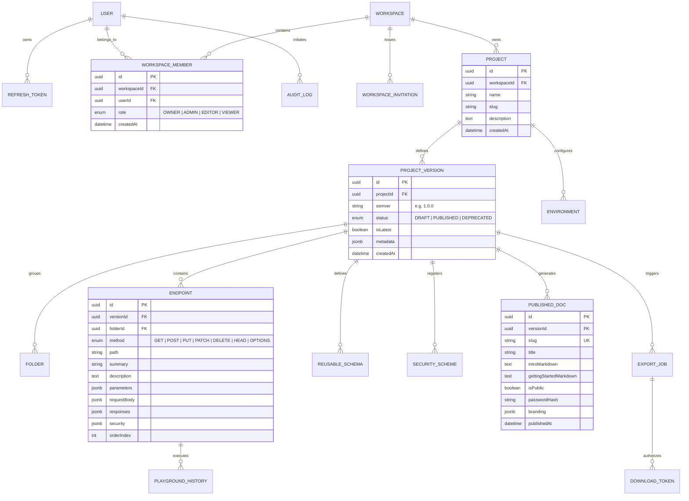

# ApiForge: Relational Database Architecture & Prisma Schema

**Document Version:** 1.0.0  
**Status:** Approved for Architectural Review (Phase Zero)  
**Author:** Principal Software Architect & Technical Research Lead  
**Classification:** Database Specification  

---

## 1. Entity-Relationship Diagram (ERD)



---

## 2. Multi-Tenancy & Isolation Principles

1. **Workspace Boundary as Tenant Root**:
   Every tenant resource (`Project`, `Environment`, `ProjectVersion`, `Endpoint`) cascades from a root `Workspace`.
2. **Guaranteed Tenant Scoping in Queries**:
   All NestJS repository queries must join through `workspaceId` and enforce membership checks:
   ```typescript
   // Example of mandatory tenant-scoped query
   const endpoint = await prisma.endpoint.findFirst({
     where: {
       id: endpointId,
       version: {
         project: {
           workspace: {
             members: { some: { userId: currentUserId } }
           }
         }
       }
     }
   });
   ```
3. **Immutability of Published Snapshots**:
   When a `ProjectVersion` is marked `PUBLISHED`, its child `Endpoint`, `Folder`, and `ReusableSchema` records become strictly read-only. Updates are applied by creating a new semantic version (e.g. `1.1.0`), preserving historic contracts for audit and consumer stability.

---

## 3. Complete Prisma Schema Definition

```prisma
datasource db {
  provider = "postgresql"
  url      = env("DATABASE_URL")
}

generator client {
  provider = "prisma-client-js"
}

enum WorkspaceRole {
  OWNER
  ADMIN
  EDITOR
  VIEWER
}

enum VersionStatus {
  DRAFT
  PUBLISHED
  DEPRECATED
}

enum HttpMethod {
  GET
  POST
  PUT
  PATCH
  DELETE
  HEAD
  OPTIONS
}

enum ExportType {
  OPENAPI_JSON
  OPENAPI_YAML
  POSTMAN_COLLECTION
  PDF_DOCUMENT
  ZIP_PACKAGE
}

enum ExportStatus {
  PENDING
  PROCESSING
  COMPLETED
  FAILED
}

model User {
  id            String            @id @default(uuid())
  email         String            @unique
  passwordHash  String
  name          String
  avatarUrl     String?
  isActive      Boolean           @default(true)
  createdAt     DateTime          @default(now())
  updatedAt     DateTime          @updatedAt

  memberships   WorkspaceMember[]
  refreshTokens RefreshToken[]
  history       PlaygroundHistory[]
  auditLogs     AuditLog[]

  @@index([email])
}

model RefreshToken {
  id        String   @id @default(uuid())
  userId    String
  user      User     @relation(fields: [userId], references: [id], onDelete: Cascade)
  tokenHash String   @unique
  expiresAt DateTime
  isRevoked Boolean  @default(false)
  createdAt DateTime @default(now())

  @@index([userId])
  @@index([tokenHash])
}

model Workspace {
  id          String              @id @default(uuid())
  name        String
  slug        String              @unique
  description String?
  createdAt   DateTime            @default(now())
  updatedAt   DateTime            @updatedAt

  members     WorkspaceMember[]
  invitations WorkspaceInvitation[]
  projects    Project[]
  auditLogs   AuditLog[]

  @@index([slug])
}

model WorkspaceMember {
  id          String        @id @default(uuid())
  workspaceId String
  workspace   Workspace     @relation(fields: [workspaceId], references: [id], onDelete: Cascade)
  userId      String
  user        User          @relation(fields: [userId], references: [id], onDelete: Cascade)
  role        WorkspaceRole @default(EDITOR)
  createdAt   DateTime      @default(now())

  @@unique([workspaceId, userId])
  @@index([userId])
}

model WorkspaceInvitation {
  id          String        @id @default(uuid())
  workspaceId String
  workspace   Workspace     @relation(fields: [workspaceId], references: [id], onDelete: Cascade)
  email       String
  role        WorkspaceRole @default(EDITOR)
  token       String        @unique
  expiresAt   DateTime
  createdAt   DateTime      @default(now())

  @@index([token])
}

model Project {
  id          String           @id @default(uuid())
  workspaceId String
  workspace   Workspace        @relation(fields: [workspaceId], references: [id], onDelete: Cascade)
  name        String
  slug        String
  description String?
  createdAt   DateTime         @default(now())
  updatedAt   DateTime         @updatedAt

  versions    ProjectVersion[]
  environments Environment[]

  @@unique([workspaceId, slug])
  @@index([workspaceId])
}

model Environment {
  id          String   @id @default(uuid())
  projectId   String
  project     Project  @relation(fields: [projectId], references: [id], onDelete: Cascade)
  name        String   // e.g. "Development", "Staging", "Production"
  baseUrl     String
  variables   Json     // Array of { key: string, value: string, isSecret: boolean }
  createdAt   DateTime @default(now())
  updatedAt   DateTime @updatedAt

  @@unique([projectId, name])
  @@index([projectId])
}

model ProjectVersion {
  id          String           @id @default(uuid())
  projectId   String
  project     Project          @relation(fields: [projectId], references: [id], onDelete: Cascade)
  semver      String           // e.g. "1.0.0"
  status      VersionStatus    @default(DRAFT)
  isLatest    Boolean          @default(true)
  metadata    Json?            // Servers, description, tags, external docs
  createdAt   DateTime         @default(now())
  updatedAt   DateTime         @updatedAt

  folders     Folder[]
  endpoints   Endpoint[]
  schemas     ReusableSchema[]
  security    SecurityScheme[]
  publishedDoc PublishedDoc?
  exportJobs  ExportJob[]

  @@unique([projectId, semver])
  @@index([projectId])
}

model Folder {
  id          String         @id @default(uuid())
  versionId   String
  version     ProjectVersion @relation(fields: [versionId], references: [id], onDelete: Cascade)
  name        String
  description String?
  orderIndex  Int            @default(0)
  createdAt   DateTime       @default(now())
  updatedAt   DateTime       @updatedAt

  endpoints   Endpoint[]

  @@index([versionId])
}

model Endpoint {
  id          String         @id @default(uuid())
  versionId   String
  version     ProjectVersion @relation(fields: [versionId], references: [id], onDelete: Cascade)
  folderId    String?
  folder      Folder?        @relation(fields: [folderId], references: [id], onDelete: SetNull)
  method      HttpMethod
  path        String
  summary     String
  description String?
  tags        String[]
  deprecated  Boolean        @default(false)
  parameters  Json           // Array of CanonicalParameter (path, query, header, cookie)
  requestBody Json?          // CanonicalRequestBody (schema, examples)
  responses   Json           // Array of CanonicalResponse (status, description, schema, examples)
  security    Json?          // Array of security requirements
  orderIndex  Int            @default(0)
  createdAt   DateTime       @default(now())
  updatedAt   DateTime       @updatedAt

  history     PlaygroundHistory[]

  @@index([versionId])
  @@index([folderId])
}

model ReusableSchema {
  id          String         @id @default(uuid())
  versionId   String
  version     ProjectVersion @relation(fields: [versionId], references: [id], onDelete: Cascade)
  name        String         // e.g. "User", "ErrorResponse"
  description String?
  schema      Json           // CanonicalSchemaDefinition
  createdAt   DateTime       @default(now())
  updatedAt   DateTime       @updatedAt

  @@unique([versionId, name])
  @@index([versionId])
}

model SecurityScheme {
  id          String         @id @default(uuid())
  versionId   String
  version     ProjectVersion @relation(fields: [versionId], references: [id], onDelete: Cascade)
  name        String         // e.g. "BearerAuth", "ApiKeyAuth"
  type        String         // "http" | "apiKey" | "oauth2" | "openIdConnect"
  scheme      String?        // "bearer" | "basic"
  inField     String?        // "header" | "query" | "cookie"
  paramName   String?        // e.g. "X-API-KEY"
  description String?
  createdAt   DateTime       @default(now())

  @@unique([versionId, name])
  @@index([versionId])
}

model PublishedDoc {
  id                     String         @id @default(uuid())
  versionId              String         @unique
  version                ProjectVersion @relation(fields: [versionId], references: [id], onDelete: Cascade)
  slug                   String         @unique
  title                  String
  introMarkdown          String?
  gettingStartedMarkdown String?
  isPublic               Boolean        @default(true)
  passwordHash           String?
  customDomain           String?
  branding               Json?          // { logoUrl, primaryColor, font }
  createdAt              DateTime       @default(now())
  updatedAt              DateTime       @updatedAt

  @@index([slug])
}

model ExportJob {
  id          String         @id @default(uuid())
  versionId   String
  version     ProjectVersion @relation(fields: [versionId], references: [id], onDelete: Cascade)
  userId      String
  type        ExportType
  status      ExportStatus   @default(PENDING)
  filePath    String?        // Internal local filesystem relative path
  fileSize    Int?
  errorMessage String?
  createdAt   DateTime       @default(now())
  updatedAt   DateTime       @updatedAt

  tokens      DownloadToken[]

  @@index([versionId])
  @@index([status])
}

model DownloadToken {
  id          String    @id @default(uuid())
  jobId       String
  job         ExportJob @relation(fields: [jobId], references: [id], onDelete: Cascade)
  token       String    @unique
  expiresAt   DateTime
  downloadCount Int     @default(0)
  maxDownloads  Int     @default(5)
  createdAt   DateTime  @default(now())

  @@index([token])
}

model PlaygroundHistory {
  id           String    @id @default(uuid())
  endpointId   String?
  endpoint     Endpoint? @relation(fields: [endpointId], references: [id], onDelete: SetNull)
  userId       String
  user         User      @relation(fields: [userId], references: [id], onDelete: Cascade)
  method       HttpMethod
  url          String
  headers      Json?
  queryParams  Json?
  body         Json?
  responseStatus Int
  durationMs   Int
  responseSizeBytes Int
  createdAt    DateTime  @default(now())

  @@index([userId])
  @@index([endpointId])
}

model AuditLog {
  id          String     @id @default(uuid())
  workspaceId String
  workspace   Workspace  @relation(fields: [workspaceId], references: [id], onDelete: Cascade)
  userId      String
  user        User       @relation(fields: [userId], references: [id], onDelete: Cascade)
  action      String     // e.g. "ENDPOINT_CREATED", "VERSION_PUBLISHED"
  targetType  String     // "ENDPOINT", "PROJECT", "WORKSPACE"
  targetId    String
  details     Json?
  ipAddress   String?
  createdAt   DateTime   @default(now())

  @@index([workspaceId])
  @@index([userId])
}
```
