# ApiForge: Master Development Roadmap

**Document Version:** 1.0.0  
**Status:** Approved for Architectural Review (Phase Zero)  
**Author:** Principal Software Architect & Technical Research Lead  
**Classification:** Engineering Roadmap  

---

## 1. Phased Execution Matrix

```mermaid
flowchart LR
    P0["Phase 0<br/>Research & Architecture"] --> P1["Phase 1<br/>Monorepo & Foundation"]
    P1 --> P2["Phase 2<br/>Auth, Tenancy & RBAC"]
    P2 --> P3["Phase 3<br/>Canonical Contract Engine"]
    P3 --> P4["Phase 4<br/>Contract CRUD & Versioning"]
    P4 --> P5["Phase 5<br/>Visual 3-Panel Studio"]
    P5 --> P6["Phase 6<br/>Docs Platform (SSR)"]
    P6 --> P7["Phase 7<br/>Playground & SSRF Proxy"]
    P7 --> P8["Phase 8<br/>Import & Export Engine"]
    P8 --> P9["Phase 9<br/>BullMQ Workers & Vault"]
    P9 --> P10["Phase 10<br/>Hardening & Verification"]
```

---

## 2. Detailed Phase Specifications

### Phase 0: Research & Architecture Approval (Completed Deliverables)
- **Deliverables**: PRD, Architecture, Tech Stack, Database Design, Security Architecture, Canonical Contract Design, API Design, Compatibility Analysis, Roadmap, ADRs.
- **Gate Criteria**: Formal stakeholder review and architectural sign-off before any code generation.

### Phase 1: Monorepo & Infrastructure Foundation
- **Tasks**:
  1. Initialize root npm workspaces (`apps/web`, `apps/api`, `packages/shared`, `storage`).
  2. Setup TypeScript project references with strict mode.
  3. Configure Docker Compose (PostgreSQL 16, Redis 7).
  4. Scaffold Next.js 14.2 App Router with Tailwind CSS and shadcn/ui.
  5. Scaffold NestJS 10.4 REST server with validation pipes and exception filters.
- **Verification**: `npm run build` passes across all workspaces; Docker Compose starts cleanly with health checks.

### Phase 2: Authentication, Tenancy & Permissions
- **Tasks**:
  1. Execute Prisma migration for Users, Workspaces, Members, and RefreshTokens.
  2. Implement Argon2id password hashing and short-lived JWT generation.
  3. Implement rotating refresh tokens in HTTP-only, SameSite=Strict cookies.
  4. Implement NestJS guards: `JwtAuthGuard`, `WorkspaceRoleGuard` (`OWNER`, `ADMIN`, `EDITOR`, `VIEWER`).
  5. Implement Next.js Server Actions for authentication with cookie forwarding.
- **Verification**: Automated test suite for registration, login, token refresh, and cross-workspace access rejection.

### Phase 3: Canonical Contract Engine (`packages/shared`)
- **Tasks**:
  1. Implement Canonical AST TypeScript interfaces.
  2. Implement Ajv 2020-12 validator with circular `$ref` graph detection.
  3. Implement contract normalization and semantic diffing utilities.
  4. Author comprehensive test fixtures with nested objects, arrays, and complex validations.
- **Verification**: 100% unit test coverage for Canonical AST validation and cycle detection.

### Phase 4: Contract CRUD & Version Management
- **Tasks**:
  1. Execute Prisma migration for Projects, Versions, Folders, Endpoints, and ReusableSchemas.
  2. Build NestJS endpoints for Folder and Endpoint CRUD.
  3. Implement semantic versioning (create draft, release version, lock published versions).
  4. Implement AuditLog interceptor recording all contract mutations.
- **Verification**: Integration tests verifying transactional endpoint creation and immutable version locking.

### Phase 5: Visual 3-Panel Contract Studio (`apps/web`)
- **Tasks**:
  1. Implement 3-panel resizable layout (`react-resizable-panels`).
  2. *Left Panel*: Searchable endpoint list with `@dnd-kit` drag-and-drop reordering and HTTP method badges.
  3. *Center Panel*: Visual form-based editor for method, path, headers, parameters, schema tree, and responses.
  4. *Right Panel*: Monaco Editor with real-time bidirectional synchronization, syntax highlighting, and Ajv error linting.
  5. Implement auto-save debouncing with conflict detection.
- **Verification**: E2E test verifying that editing visual form fields instantaneously updates the Monaco JSON editor and vice-versa.

### Phase 6: Professional Documentation Platform (SSR & Dynamic Engine)
- **Tasks**:
  1. Implement Server-Side Rendered (SSR) project landing page (`/[projectId]/docs` and `/docs/[slug]`).
  2. Build sticky header with version selector, export menu, and theme toggle.
  3. Build sticky left navigation with bidirectional `IntersectionObserver` and stable URL hash sync (`#authentication`, `#post-api-v1-users`).
  4. Build main content parameter tables, request body schema viewer, and response code tabs.
  5. Implement multi-language code snippet generator (cURL, Fetch, Python Requests, Go net/http).
  6. Implement instant `Cmd+K` documentation search modal.
- **Verification**: Lighthouse audit verifying fast FCP (< 300ms) and zero layout shift; browser history hash navigation tests.

### Phase 7: API Playground & SSRF-Hardened Execution
- **Tasks**:
  1. Build Postman-style UI (Method selector, URL bar, Params/Headers/Auth/Body tabs).
  2. Implement NestJS `PlaygroundProxyService`:
     - URL validation (http/https only).
     - Pre-connect DNS lookup against IPv4/IPv6 private & cloud metadata blocklists.
     - Socket IP pinning defeating DNS rebinding.
     - 10s timeout and 10MB payload size limits.
  3. Capture high-resolution timing (DNS, TCP, TTFB, total ms) and byte size telemetry.
  4. Store execution history for one-click test replay.
- **Verification**: Automated security tests proving blocking of `127.0.0.1`, `169.254.169.254`, `::ffff:127.0.0.1`, and DNS rebinding hosts.

### Phase 8: Spec Import & Export Engine
- **Tasks**:
  1. Build synchronous OpenAPI 3.1.0 JSON and YAML serializers.
  2. Build synchronous Postman Collection v2.1.0 serializer.
  3. Implement OpenAPI 3.x and Postman 2.1 importers with detailed diagnostic reporting.
  4. Implement round-trip test harness verifying semantic contract preservation.
- **Verification**: Conformance testing with official Petstore and complex multi-schema specs.

### Phase 9: Background Processing & Secure Local Vault
- **Tasks**:
  1. Configure BullMQ worker process connected to Redis.
  2. Implement Playwright headless Chromium PDF worker with vector print styling and table of contents.
  3. Implement Archiver streaming ZIP packager combining OpenAPI, Postman, PDF, and offline HTML.
  4. Implement `LocalStorageService`:
     - Path traversal protection (`path.resolve` + storage root validation).
     - UUID-based file storage in `./storage/exports`.
     - Opaque cryptographically random download tokens (`/api/v1/storage/download/:token`).
     - Scheduled cron cleanup of exports > 24 hours.
- **Verification**: Async job tests confirming non-blocking PDF generation and streaming file downloads.

### Phase 10: Production Hardening & Final Verification
- **Tasks**:
  1. Author multi-stage Dockerfiles and Docker Compose configuration for local and on-prem deployment.
  2. Conduct full end-to-end integration tests (Auth -> Design -> Docs -> Playground -> Export -> Download).
  3. Author deployment, operational, and backup documentation.
- **Verification**: Complete test pass across all layers with verified zero-trust security.
