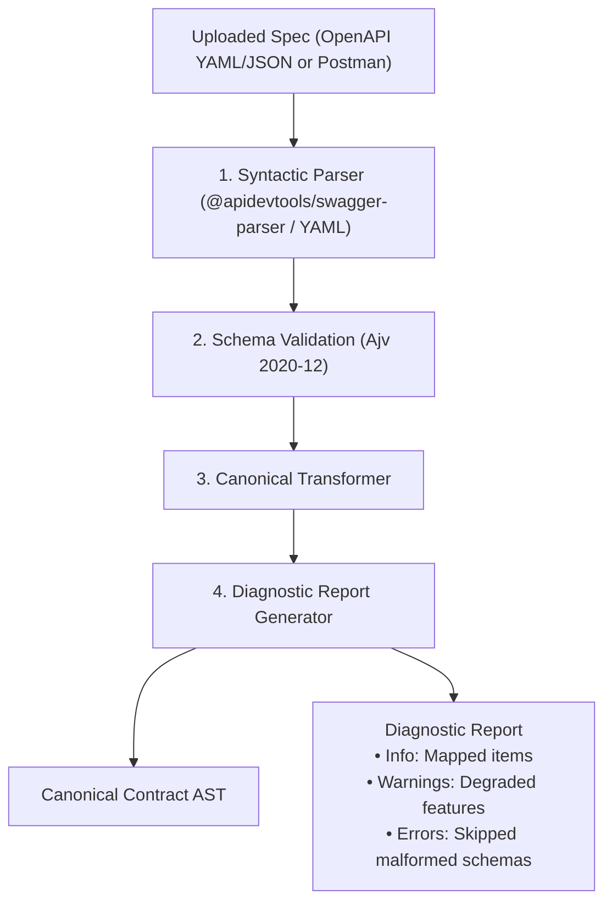

# ApiForge: Spec Import & Export Compatibility Analysis

**Document Version:** 1.0.0  
**Status:** Approved for Architectural Review (Phase Zero)  
**Author:** Principal Software Architect & Technical Research Lead  
**Classification:** Interoperability Report  

---

## 1. Specification Compatibility Matrix

ApiForge supports bidirectional transformation between its Canonical AST and major industry specifications. To uphold engineering integrity, ApiForge **never claims 100% byte-for-byte equality** across heterogeneous specifications; instead, it enforces **semantic preservation** and issues explicit diagnostic reports for unmapped features.

| Spec Feature | Canonical AST | OpenAPI 3.1.0 | Postman Collection v2.1 | Semantic Fidelity & Mapping Notes |
| :--- | :---: | :---: | :---: | :--- |
| **HTTP Methods** | Full | Full | Full | Lossless: `GET`, `POST`, `PUT`, `PATCH`, `DELETE`, `HEAD`, `OPTIONS`. |
| **Path & Query Parameters** | Full | Full | Full | Lossless: Name, required flag, description, examples, schema. |
| **Header Parameters** | Full | Full | Full | Lossless: Standard and custom headers. |
| **Cookie Parameters** | Full | Full | Limited | Postman collections support headers representing cookies, but lack dedicated cookie parameter AST nodes. |
| **JSON Schema 2020-12** | Full | Full | Partial | OpenAPI 3.1 natively aligns with JSON Schema 2020-12. Postman relies on JSON Schema Draft 4/7 for validation. Postman imports/exports preserve structure via schema definition strings. |
| **Multiple Response Codes** | Full | Full | Full | Lossless: 200, 201, 400, 404, 500, etc., with response bodies. |
| **Reusable Components ($ref)** | Full | Full | None | Postman collections do not have a reusable schema registry; schemas are expanded into inline representations when exporting to Postman. |
| **Pre-request / Test Scripts** | N/A | None | Native JS | Postman test scripts (e.g. `pm.expect()`) have no standard representation in OpenAPI or Canonical AST. Stored in `extensions.postman_scripts` during import and flagged with a diagnostic warning. |
| **Security Schemes** | Full | Full | Full | Bearer JWT, Basic Auth, API Key (Header/Query) map losslessly. OAuth2 complex flow metadata maps to OpenAPI 3.1; simplified token headers map to Postman. |
| **Folder Hierarchy** | Full | Tags (Flat/Tree) | Folders (Nested) | Canonical AST folders map directly to Postman folders, and to OpenAPI `tags` with `x-tagGroups` extensions. |

---

## 2. Transformation Diagnostics & Information-Loss Reporting

When importing an external specification, ApiForge executes a multi-pass diagnostic pipeline:



### Example Diagnostic Report Response
```json
{
  "success": true,
  "data": {
    "versionId": "b1a2c3d4-...",
    "endpointsImported": 34,
    "schemasImported": 12,
    "diagnostics": {
      "errors": [],
      "warnings": [
        {
          "code": "W_POSTMAN_SCRIPTS_UNSUPPORTED",
          "message": "Endpoint 'POST /auth/login' contained Postman test scripts. Scripts are preserved in metadata but cannot execute inside OpenAPI exports.",
          "location": "item[0].event[1]"
        },
        {
          "code": "W_SCHEMA_FALLBACK",
          "message": "Property 'created_at' in schema 'User' used unrecognized format 'custom-epoch'. Fallback to 'string' applied.",
          "location": "components.schemas.User.properties.created_at"
        }
      ]
    }
  }
}
```
