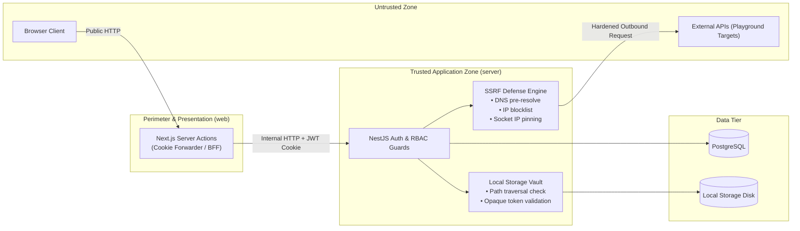
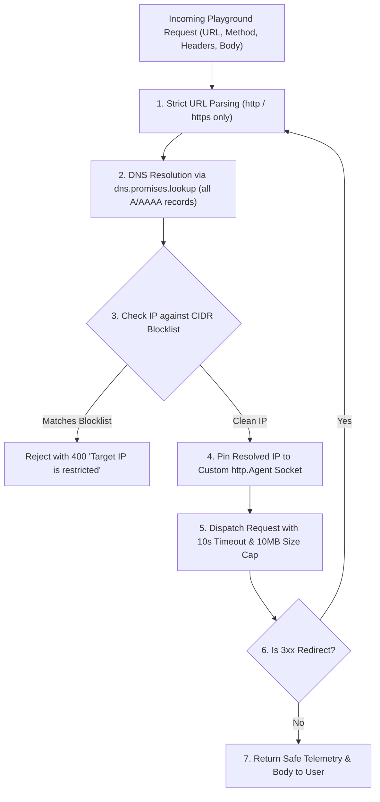

# ApiForge: Comprehensive Security Architecture Specification

**Document Version:** 1.0.0  
**Status:** Approved for Architectural Review (Phase Zero)  
**Author:** Principal Software Architect & Technical Research Lead  
**Classification:** Security Architecture  

---

## 1. Threat Model & Security Boundaries

ApiForge processes sensitive API contracts, proprietary schemas, authentication tokens, and outbound network traffic. The security architecture operates on **Zero Trust**: Next.js Server Actions, client browsers, and external webhooks are untrusted. Every state transition and data access is verified by NestJS guards.



---

## 2. Authentication & Session Management

1. **Password Hashing (Argon2id)**:
   - Evaluated over bcrypt due to memory hardness, resisting GPU/FPGA brute-force attacks.
   - Parameters: Memory cost = 65,536 KiB (64 MiB), Time cost = 3 iterations, Parallelism = 4 threads.
2. **Token Strategy**:
   - **Access Token**: Short-lived (15 minutes), signed with RS256 or HS256, containing `{ sub: userId, email }`.
   - **Refresh Token**: Long-lived (7 days), stored hashed with SHA-256 in the database. Rotated on every use; reuse triggers immediate family revocation (theft mitigation).
   - **Cookie Configuration**:
     - `HttpOnly`: Inaccessible to client JavaScript (XSS mitigation).
     - `Secure`: Transmitted only over HTTPS.
     - `SameSite=Strict`: Protects against Cross-Site Request Forgery (CSRF).
     - `Path=/api`: Restricted to API paths.

---

## 3. Server-Side Request Forgery (SSRF) Defense

The API Playground allows users to send arbitrary HTTP requests. If unprotected, attackers could probe localhost, internal Docker networks, or cloud metadata endpoints (`169.254.169.254`).



### 3.1 Strict IP Blacklisting Rules
Every resolved IP is checked against the following ranges:
- **IPv4 Loopback**: `127.0.0.0/8`
- **IPv4 Private (RFC 1918)**: `10.0.0.0/8`, `172.16.0.0/12`, `192.168.0.0/16`
- **Carrier-Grade NAT (RFC 6598)**: `100.64.0.0/10`
- **Link-Local & Cloud Metadata**: `169.254.0.0/16` (Specifically blocks AWS/GCP/Azure `169.254.169.254`)
- **Broadcast & Reserved**: `0.0.0.0/8`, `224.0.0.0/4`, `240.0.0.0/4`, `255.255.255.255/32`
- **IPv6 Loopback**: `::1/128`
- **IPv6 Unique Local (ULA)**: `fc00::/7`
- **IPv6 Link-Local**: `fe80::/10`
- **IPv4-Mapped IPv6**: `::ffff:0:0/96` (Prevents bypasses like `::ffff:127.0.0.1`)

### 3.2 DNS Rebinding Protection
Attackers can return a benign public IP on first DNS resolution and `127.0.0.1` on the second. To defeat this, ApiForge resolves the DNS upfront and forces the HTTP client socket (`lookup` callback in `http.Agent` / `https.Agent`) to connect **only** to the pre-validated IP address.

---

## 4. Secure Local Filesystem Storage Vault

Replacing AWS S3 with local disk volumes requires strict filesystem defenses:

1. **Path Traversal Prevention (`E_PATH_TRAVERSAL`)**:
   ```typescript
   function validateSafePath(rootDir: string, userPath: string): string {
     // Strip null bytes
     const clean = userPath.replace(/\0/g, '');
     const resolved = path.resolve(rootDir, clean);
     if (!resolved.startsWith(rootDir + path.sep) && resolved !== rootDir) {
       throw new ForbiddenException('Path traversal attempt detected');
     }
     return resolved;
   }
   ```
2. **UUID File Keys**:
   Files on disk are named strictly via generated UUIDs: `./storage/exports/b7a9f8e2-411a-42c2-b5e1-8f2c0918c7d3.pdf`. User-supplied file names are stored in database metadata only.
3. **Opaque Download Tokens**:
   Files are accessed via `/api/v1/storage/download/:token`. The token is a 64-character hexadecimal cryptographically secure random string mapped to a database record with a 15-minute expiration and a maximum download counter.
4. **Execution Prevention**:
   The `./storage` volume is mounted with `noexec` flags in production Docker containers, ensuring uploaded or generated files cannot be executed by the operating system.

---

## 5. Defense-in-Depth Measures

- **HTTP Security Headers (Helmet)**:
  - `Content-Security-Policy`: Restricts script and style origins.
  - `X-Frame-Options: DENY`: Prevents clickjacking.
  - `X-Content-Type-Options: nosniff`: Prevents MIME-sniffing exploits.
  - `Strict-Transport-Security`: Enforces HTTPS.
- **Rate Limiting**:
  - Global API rate limiting via `@nestjs/throttler` (e.g. 100 requests per minute).
  - Strict auth rate limiting (5 failed login attempts per IP per 15 minutes).
  - Outbound playground rate limiting (10 requests per minute per user).
