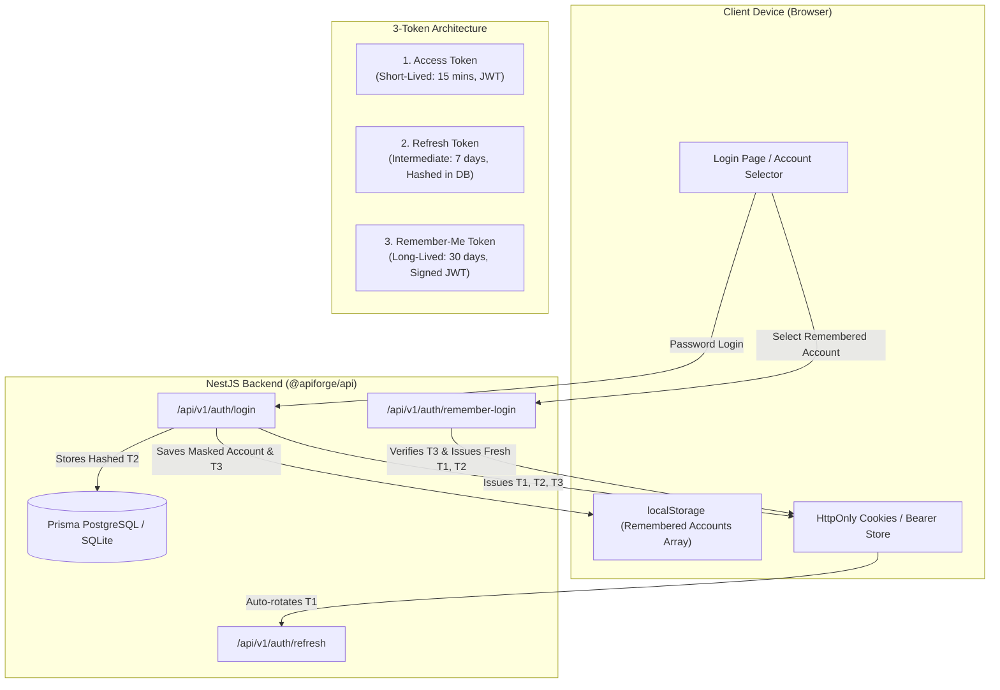
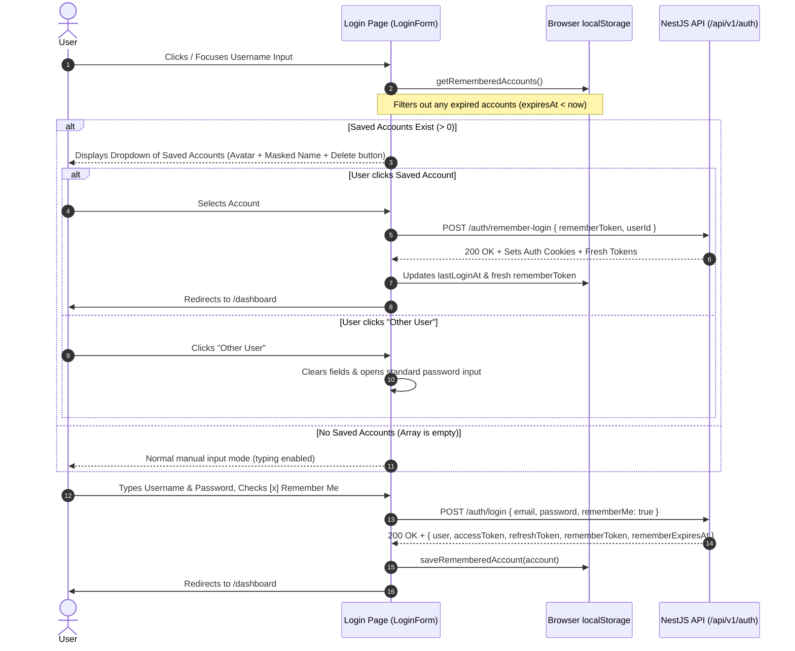

# 3-Token Authentication Architecture & Integration Guide

ApiForge implements a secure, enterprise-grade **3-Token Authentication Architecture** designed to balance immediate authorization speed, robust session rotation, and seamless multi-account persistence across client sessions.

---

## 1. Token Hierarchy & Roles



| Token | Lifecycle | Storage Mechanism | Revocation & Rotation | Purpose |
| :--- | :--- | :--- | :--- | :--- |
| **Access Token** | 15 Minutes | `HttpOnly` Cookie & `Authorization: Bearer` Header | Short expiration; verified statelessly via `JWT_ACCESS_SECRET`. | Used for all active API interactions and GraphQL/REST endpoints. |
| **Refresh Token** | 7 Days | `HttpOnly` Cookie (`strict`, `path: /`) | SHA-256 hashed in database (`RefreshToken` table); rotated on each `/auth/refresh` call. Token reuse revokes all user sessions. | Automatically renews expired Access Tokens without prompting the user. |
| **Remember-Me Token** | 30 Days | Client `localStorage` array of objects (immune to cookie blocking/third-party restrictions) | Cryptographically signed JWT (`type: 'remember_me'`) verified on `/auth/remember-login`; rotates on each re-entry. | Multi-account device memory & 1-click passwordless sign-in. |

---

## 2. 'Remember Me' Client Storage & Privacy Masking

Because cookies are frequently blocked by privacy extensions, incognito windows, or strict cross-site policies, Remember-Me credentials are stored in `localStorage` under the key `apiforge_remembered_accounts`.

### Masking Formula
To protect user privacy on shared screens or workstations, identifiers are masked using the following rules:

$$\text{Mask}(u) = \begin{cases} 
\text{slice}(0, 2) + \text{"***"} + \text{slice}(-2) & \text{if } \text{length}(u) > 5 \\
\text{slice}(0, 1) + \text{"**"} + \text{slice}(-1) & \text{if } \text{length}(u) \le 5 
\end{cases}$$

#### Examples:
- `christopher` $\rightarrow$ `ch***er`
- `shilpa` $\rightarrow$ `sh***pa`
- `john` $\rightarrow$ `j**n`
- `alex` $\rightarrow$ `a**x`
- `developer@example.com` $\rightarrow$ `de***er@example.com`

### Saved Account Object Schema
```typescript
interface RememberedAccount {
  id: string;               // Unique user UUID
  name: string;             // User display name
  email: string;            // User email address
  username: string;         // Clean identifier
  maskedUsername: string;   // Privacy masked display string (e.g. jo***hn)
  rememberToken: string;    // Signed 30-day Remember-Me JWT
  expiresAt: number;        // Epoch timestamp (ms) when token expires
  lastLoginAt: number;      // Epoch timestamp (ms) of last successful authentication
}
```

---

## 3. Login User Flow



---

## 4. Backend Endpoints Specification

### 1. Standard Login with Remember-Me
- **URL**: `POST /api/v1/auth/login`
- **Request Body**:
  ```json
  {
    "email": "developer@example.com",
    "password": "SecurePassword123!",
    "rememberMe": true
  }
  ```
- **Response (`200 OK`)**:
  ```json
  {
    "success": true,
    "data": {
      "user": {
        "id": "6ae65ce3-f15b-4bed-980b-92ca7fccb0e1",
        "email": "developer@example.com",
        "name": "Developer"
      },
      "accessToken": "eyJhbGciOi...",
      "refreshToken": "4a71...",
      "rememberToken": "eyJhbGciOi...",
      "rememberExpiresAt": 1793716800000
    }
  }
  ```

### 2. Passwordless Remember-Me Re-entry
- **URL**: `POST /api/v1/auth/remember-login`
- **Request Body**:
  ```json
  {
    "rememberToken": "eyJhbGciOi...",
    "userId": "6ae65ce3-f15b-4bed-980b-92ca7fccb0e1"
  }
  ```
- **Response (`200 OK`)**:
  ```json
  {
    "success": true,
    "data": {
      "user": { ... },
      "accessToken": "eyJhbGciOi...",
      "refreshToken": "...",
      "rememberToken": "eyJhbGciOi...",
      "rememberExpiresAt": 1793716800000
    }
  }
  ```

### 3. Session Refresh
- **URL**: `POST /api/v1/auth/refresh`
- **Cookies**: `refresh_token=...`
- **Response (`200 OK`)**:
  ```json
  {
    "success": true,
    "data": {
      "accessToken": "eyJhbGciOi..."
    }
  }
  ```

---

## 5. Security & Expiration Safeguards

1. **Automatic Pruning**: Whenever `getRememberedAccounts()` is invoked, any entry whose `expiresAt <= Date.now()` is instantly removed from `localStorage`.
2. **Server-Side Token Verification**: The `rememberToken` is cryptographically signed and verified using `JWT_REMEMBER_SECRET`. Even if a user alters the local storage values, invalid signatures are rejected with `401 Unauthorized`.
3. **Session Revocation**: If a user is deactivated in the database (`isActive: false`), both password login and remember-login immediately fail and purge the saved credentials.
4. **Token Rotation**: Every time a user signs in via a remember token, the backend generates and returns a freshly rotated remember token with a renewed 30-day lifespan.
